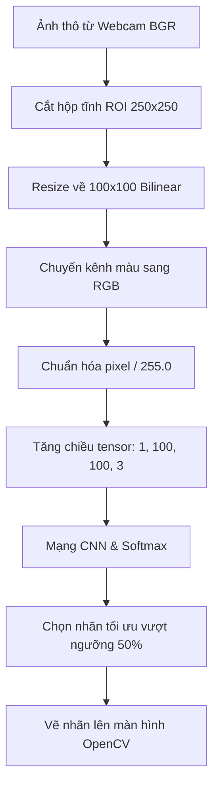

# BÁO CÁO HỌC PHẦN: NHẬP MÔN TRÍ TUỆ NHÂN TẠO

**ĐỀ TÀI:** PHÂN LOẠI ẢNH ĐƠN GIẢN BẰNG CNN – NHẬN DIỆN KÝ HIỆU NGÔN NGỮ ASL  
**Giảng viên hướng dẫn:** Trần Đình Tân  
**Sinh viên thực hiện:** Lê Quang Anh  
**Mã số sinh viên (MSSV):** 24100414  

---

## MỤC LỤC

[DANH MỤC THUẬT NGỮ VÀ TỪ VIẾT TẮT](#danh-mục-thuật-ngữ-và-từ-viết-tắt)  
[BẢNG PHÂN CÔNG CÔNG VIỆC VÀ ĐÓNG GÓP](#bảng-phân-công-công-việc-và-đóng-góp)  
[1. GIỚI THIỆU](#1-giới-thiệu)  
&emsp;[1.1 Bối cảnh nghiên cứu](#11-bối-cảnh-nghiên-cứu)  
&emsp;[1.2 Động lực nghiên cứu và ý tưởng cốt lõi](#12-động-lực-nghiên-cứu-và-ý-tưởng-cốt-lõi)  
&emsp;[1.3 Mục tiêu cụ thể của đề tài](#13-mục-tiêu-cụ-thể-của-đề-tài)  
&emsp;[1.4 Đối tượng phục vụ và tính ứng dụng thực tiễn](#14-đối-tượng-phục-vụ-và-tính-ứng-dụng-thực-tiễn)  
&emsp;[1.5 Cấu trúc chi tiết của báo cáo](#15-cấu-trúc-chi-tiết-của-báo-cáo)  
[2. PHÁT BIỂU BÀI TOÁN](#2-phát-biểu-bài-toán)  
&emsp;[2.1 Mô tả chi tiết bài toán](#21-mô-tả-chi-tiết-bài-toán)  
&emsp;[2.2 Các đặc trưng của dữ liệu cử chỉ tay](#22-các-đặc-trưng-của-dữ-liệu-cử-chỉ-tay)  
&emsp;[2.3 Mô hình hóa toán học chặt chẽ](#23-mô-hình-hóa-toán-học-chặt-chẽ)  
&emsp;[2.4 Các khó khăn và thách thức thực tế](#24-các-khó-khăn-và-thách-thức-thực-tế)  
[3. NGHIÊN CỨU LIÊN QUAN](#3-nghiên-cứu-liên-quan)  
&emsp;[3.1 Các phương pháp truyền thống trích xuất đặc trưng thủ công](#31-các-phương-pháp-truyền-thống-trích-xuất-đặc-trưng-thủ-công)  
&emsp;[3.2 Các hướng tiếp cận học sâu hiện đại](#32-các-hướng-tiếp-cận-học-sâu-hiện-đại)  
&emsp;[3.3 Bảng phân tích so sánh chi tiết](#33-bảng-phân-tích-so-sánh-chi-tiết)  
[4. PHƯƠNG PHÁP ĐỀ XUẤT](#4-phương-pháp-đề-xuất)  
&emsp;[4.1 Đường ống xử lý chi tiết (Pipeline)](#41-đường-ống-xử-lý-chi-tiết-pipeline)  
&emsp;[4.2 Chi tiết kiến trúc mô hình tự thiết kế](#42-chi-tiết-kiến-trúc-mô-hình-tự-thiết-kế)  
&emsp;[4.3 Phân tích độ phức tạp thuật toán (Time & Space Complexity)](#43-phân-tích-độ-phức-tạp-thuật-toán-time--space-complexity)  
&emsp;[4.4 Luồng hoạt động của hệ thống (Workflow)](#44-luồng-hoạt-động-của-hệ-thống-workflow)  
[5. KẾT QUẢ THỰC NGHIỆM](#5-kết-quả-thực-nghiệm)  
&emsp;[5.1 Cấu hình thực nghiệm](#51-cấu-hình-thực-nghiệm)  
&emsp;[5.2 Các bộ dữ liệu sử dụng](#52-các-bộ-dữ-liệu-sử-dụng)  
&emsp;[5.3 Các tiêu chí đánh giá](#53-các-tiêu-chí-đánh-giá)  
&emsp;[5.4 Phân tích kết quả thực nghiệm chi tiết](#54-phân-tích-kết-quả-thực-nghiệm-chi-tiết)  
[6. KẾT LUẬN & HƯỚNG PHÁT TRIỂN](#6-kết-luận--hướng-phát-triển)  
&emsp;[6.1 Kết luận khoa học đạt được](#61-kết-luận-khoa-học-đạt-được)  
&emsp;[6.2 Hạn chế kỹ thuật hiện tại](#62-hạn-chế-kỹ-thuật-hiện-tại)  
&emsp;[6.3 Hướng phát triển mở rộng trong tương lai](#63-hướng-phát-triển-mở-rộng-trong-tương-lai)  
[TÀI LIỆU THAM KHẢO](#tài-liệu-tham-khảo)  

---

## DANH MỤC THUẬT NGỮ VÀ TỪ VIẾT TẮT

*Bảng 1.1: Danh sách các thuật ngữ và từ viết tắt*

| Kí hiệu / Thuật ngữ viết tắt | Ý nghĩa / Giải thích |
| :--- | :--- |
| **ASL** | American Sign Language (Ngôn ngữ ký hiệu Mỹ) |
| **CNN** | Convolutional Neural Network (Mạng nơ-ron tích chập) |
| **ReLU** | Rectified Linear Unit (Đơn vị tuyến tính chỉnh lưu - hàm kích hoạt) |
| **Adam** | Adaptive Moment Estimation (Thuật toán tối ưu hóa thích nghi theo mô-men) |
| **BN** | Batch Normalization (Chuẩn hóa dữ liệu trung gian theo lô) |
| **Dropout** | Kỹ thuật ngắt kết nối ngẫu nhiên một tỷ lệ nơ-ron để chống quá khớp |
| **Loss** | Hàm mất mát / Hàm lỗi (Đo lường sai lệch giữa dự đoán và nhãn thực tế) |
| **Accuracy** | Độ chính xác phân loại (Tỷ lệ phần trăm các mẫu phân loại đúng) |
| **Overfitting** | Hiện tượng quá khớp (Học thuộc lòng dữ liệu train, kém trên dữ liệu test mới) |
| **Data Augmentation** | Tăng cường dữ liệu (Xoay, dịch, zoom ảnh... để tăng tính đa dạng dữ liệu) |
| **GUI** | Graphical User Interface (Giao diện đồ họa người dùng) |
| **FPS** | Frames Per Second (Số khung hình trên giây) |

---

## BẢNG PHÂN CÔNG CÔNG VIỆC VÀ ĐÓNG GÓP

*Bảng 1.2: Bảng phân công công việc và tỉ lệ đóng góp của thành viên*

| STT | MSV | Họ tên | Công việc phân công | Tỉ lệ % |
| :---: | :---: | :--- | :--- | :---: |
| 1 | 24100414 | **Lê Quang Anh** (Nhóm trưởng) | Làm slides báo cáo; Viết báo cáo học thuật hoàn chỉnh; Lập trình toàn bộ mô hình Base CNN và mô hình cải tiến; Xây dựng giao diện máy tính Tkinter GUI & ứng dụng Webcam thời gian thực OpenCV. | 100% |

---

## 1. GIỚI THIỆU

### 1.1 Bối cảnh nghiên cứu
Ngôn ngữ ký hiệu (Sign Language) là hệ thống giao tiếp bằng cử điệu cơ thể, nét mặt và đặc biệt là tư thế của đôi bàn tay để chuyển tải thông tin. Đây là ngôn ngữ chính thức và cực kỳ quan trọng đối với cộng đồng người khiếm thính và khiếm ngôn trên toàn thế giới. Theo thống kê của Hiệp hội Người khiếm thính Thế giới (WFD), hiện nay có hơn 72 triệu người khiếm thính toàn cầu sử dụng hơn 300 ngôn ngữ ký hiệu khác nhau để giao tiếp hàng ngày. Riêng tại Việt Nam, con số người khuyết tật ngôn ngữ và thính giác ước tính lên tới hàng triệu người. Tuy nhiên, một thực tế khó khăn là phần lớn xã hội bình thường không có khả năng hiểu hoặc sử dụng ngôn ngữ ký hiệu. Điều này vô hình trung tạo ra một bức tường ngăn cách lớn, cản trở người khiếm thính tiếp cận bình đẳng với các dịch vụ công cộng, giáo dục, y tế và cơ hội việc làm.

Sự bùng nổ mạnh mẽ của Trí tuệ Nhân tạo (Artificial Intelligence), Học máy (Machine Learning) và đặc biệt là Học sâu (Deep Learning) kết hợp với các kỹ thuật Thị giác máy tính (Computer Vision) đã mở ra những chân trời mới để giải quyết bài toán nhân văn này. Việc phát triển các hệ thống tự động nhận diện và chuyển ngữ ngôn ngữ ký hiệu theo thời gian thực (Real-time Sign Language Translation) đang trở thành một hướng nghiên cứu cấp thiết và đầy tiềm năng. Nếu có thể xây dựng một giải pháp AI tự động nhận dạng chính xác các ký hiệu tay thông qua camera thông thường, chúng ta có thể tạo ra các công cụ dịch thuật tức thời, phá vỡ rào cản giao tiếp lâu đời này.

### 1.2 Động lực nghiên cứu và ý tưởng cốt lõi
Động lực thúc đẩy nhóm nghiên cứu thực hiện đề tài này bắt nguồn từ mong muốn tạo dựng một ứng dụng nhận diện ngôn ngữ ký hiệu Mỹ (American Sign Language - ASL) thực tế, nhỏ gọn và có độ chính xác cao. Bảng chữ cái ký hiệu tay ASL bao gồm các chữ cái từ A đến Z cùng một số ký hiệu chức năng phụ trợ là nền tảng cơ bản nhất. Bất kỳ ai muốn giao tiếp hoặc học ngôn ngữ ký hiệu đều phải bắt đầu từ việc đánh vần từng ký tự chữ cái này (fingerspelling).

Trong lĩnh vực học sâu, nhiều nghiên cứu trước đây thường áp dụng các kiến trúc mạng nơ-ron tích chập (CNN) rất sâu và cồng kềnh như ResNet-50, VGG-16 hoặc các mô hình Transformer khổng lồ để đạt độ chính xác cao. Mặc dù các mô hình này hoạt động tốt trên các máy chủ có card đồ họa (GPU) mạnh mẽ, chúng lại bộc lộ hạn chế lớn khi triển khai trên các thiết bị đầu cuối thông thường (Edge devices) hoặc chạy trên CPU của máy tính cá nhân do độ trễ lớn và đòi hỏi bộ nhớ quá cao. Điều này làm mất đi tính ứng dụng thực tế của một phần mềm giao tiếp thời gian thực, nơi tốc độ phản hồi tính bằng mili-giây là yếu tố quyết định trải nghiệm người dùng.

Do đó, ý tưởng cốt lõi của đề tài này là tự thiết kế một kiến trúc mạng CNN nông tùy chỉnh (custom shallow CNN) vô cùng tối giản, hạn chế tối đa số lượng lớp tích chập và tham số mạng để tối ưu hóa tốc độ xử lý trên CPU. Tuy nhiên, thách thức đặt ra là làm thế nào để một mô hình nông và nhẹ vẫn giữ được độ chính xác phân loại tương đương hoặc vượt trội so với các kiến trúc sâu. Đề tài sẽ tập trung giải quyết bài toán này thông qua việc tối ưu quy trình xử lý ảnh và nghiên cứu thực nghiệm đối chứng sâu sắc về tác động của quy mô dữ liệu cũng như các kỹ thuật Regularization.

### 1.3 Mục tiêu cụ thể của đề tài
* Thiết kế và cài đặt thành công một kiến trúc mạng nơ-ron tích chập (CNN) tùy chỉnh nông, hướng tới mục tiêu tối thiểu hóa tài nguyên phần cứng và tối đa hóa tốc độ suy luận (inference speed) trên CPU thông thường.
* Phân loại chính xác 29 lớp ký tự của bảng chữ cái ASL, bao gồm 26 chữ cái tiếng Anh từ A đến Z, cùng 3 nhãn bổ trợ chức năng là 'del' (xóa ký tự trước đó), 'space' (dấu cách khoảng trắng) và 'nothing' (trạng thái tĩnh, không có bàn tay ra dấu).
* Thực hiện các chuỗi thực nghiệm đối chứng chi tiết để nghiên cứu sâu sắc về cơ chế kiểm soát hiện tượng quá khớp (Overfitting), đánh giá tác động thực tế của quy mô tập dữ liệu huấn luyện và các phương pháp Regularization phổ biến như Batch Normalization, Dropout và đặc biệt là Tăng cường dữ liệu (Data Augmentation).
* Xây dựng thành công ứng dụng giao diện đồ họa tương tác (GUI) bằng thư viện Tkinter hiển thị trực quan top-3 dự đoán tốt nhất kèm độ tin cậy, kết hợp với ứng dụng nhận diện qua Webcam thời gian thực bằng thư viện OpenCV sử dụng khung định vị bàn tay cố định.

### 1.4 Đối tượng phục vụ và tính ứng dụng thực tiễn
Đối tượng phục vụ chính của đề tài là cộng đồng người khiếm thính và khiếm ngôn, giúp họ có một công cụ hỗ trợ biểu đạt ý kiến tới người bình thường một cách nhanh chóng. Đồng thời, ứng dụng cũng là một giáo trình tương tác trực quan cho những người bình thường bắt đầu học tập ngôn ngữ ký hiệu, cho phép họ đưa tay trước camera và nhận được phản hồi đánh giá ngay lập tức xem mình đã tạo hình dáng ký hiệu đúng chưa.

Về tính ứng dụng thực tế, mô hình CNN nhỏ gọn sau khi được huấn luyện có thể dễ dàng tích hợp vào các nền tảng web chạy trực tiếp trên trình duyệt, các ứng dụng di động gọn nhẹ chạy ngoại tuyến (offline) mà không cần kết nối internet tới máy chủ GPU đắt đỏ. Nó có thể được cài đặt tại các quầy dịch vụ công, bệnh viện hoặc trường học để hỗ trợ giao tiếp cơ bản giữa nhân viên công vụ và người khiếm thính.

### 1.5 Cấu trúc chi tiết của báo cáo
Báo cáo học phần này được tổ chức thành 6 chương nội dung chính như sau:
* **Chương 1:** Giới thiệu tổng quan về bối cảnh nghiên cứu, động lực phát triển đề tài, mục tiêu và ý nghĩa thực tiễn.
* **Chương 2:** Phát biểu bài toán, mô tả chi tiết các nhãn dữ liệu, xây dựng mô hình hóa toán học chặt chẽ và chỉ ra các thách thức kỹ thuật.
* **Chương 3:** Khảo cứu các nghiên cứu liên quan, so sánh phương pháp truyền thống trích xuất đặc trưng thủ công với các hướng tiếp cận học sâu hiện đại.
* **Chương 4:** Trình bày chi tiết phương pháp đề xuất bao gồm sơ đồ khối đường ống xử lý (Pipeline), cấu trúc toán học của từng lớp trong mạng CNN, và luồng hoạt động (Workflow) của các ứng dụng demo.
* **Chương 5:** Trình bày cấu hình thực nghiệm, mô tả bộ dữ liệu sử dụng, phân tích khoa học kết quả thu được từ 3 kịch bản huấn luyện đối chứng và phân tích lỗi thông qua ma trận nhầm lẫn.
* **Chương 6:** Đưa ra kết luận tổng kết các kết quả đạt được, thẳng thắn nhìn nhận các hạn chế kỹ thuật hiện tại và đề xuất hướng phát triển mở rộng trong tương lai.

---

## 2. PHÁT BIỂU BÀI TOÁN

### 2.1 Mô tả chi tiết bài toán
Bài toán nhận diện ký hiệu bảng chữ cái ASL thuộc lớp bài toán **Phân loại ảnh tĩnh nhiều lớp (Multi-class Image Classification)** trong Thị giác máy tính. Nhiệm vụ cụ thể là: cho trước một hình ảnh chứa bàn tay đang thực hiện một cử chỉ ký hiệu tay thuộc bảng chữ cái ASL, hệ thống phải tự động phân tích các đặc trưng hình ảnh và đưa ra dự đoán nhãn ký tự tương ứng chính xác nhất.

Trong đề tài này, không gian nhãn đầu ra bao gồm đúng 29 lớp ký tự khác nhau. Sự đa dạng này đòi hỏi mô hình phải có năng lực phân biệt rất tốt. Các lớp cụ thể được định nghĩa bao gồm:
* 26 chữ cái đơn từ A đến Z trong bảng chữ cái Latin tiếng Anh, mỗi chữ cái tương ứng với một hình dáng gập ngón tay và xoay cổ tay đặc trưng theo chuẩn ASL.
* Nhãn 'space' biểu diễn cử chỉ lòng bàn tay mở rộng khép các ngón để ra hiệu tạo khoảng trắng ngăn cách giữa hai từ trong câu.
* Nhãn 'del' biểu diễn cử chỉ đưa tay vuốt ngang để yêu cầu xóa ký tự vừa nhập trước đó.
* Nhãn 'nothing' biểu diễn trạng thái hậu cảnh trống hoặc bàn tay đang ở trạng thái nghỉ, không biểu diễn bất kỳ ký hiệu nào, giúp hệ thống tránh nhận diện nhầm khi người dùng hạ tay xuống.

### 2.2 Các đặc trưng của dữ liệu cử chỉ tay
Dữ liệu cử chỉ bàn tay có những đặc trưng vật lý rất khác biệt so với các bộ dữ liệu ảnh thông thường như động vật hay phong cảnh. Ảnh bàn tay chứa các thông tin cấu trúc hình học cực kỳ phức tạp: số lượng ngón tay xòe ra hay gập lại, khoảng cách tương đối giữa các đầu ngón tay, góc nghiêng của các đốt ngón tay so với lòng bàn tay, và sự xuất hiện hay che khuất của ngón tay cái.

Ảnh đầu vào thực tế được thu thập qua camera webcam dưới dạng ảnh màu 3 kênh RGB. Để phục vụ huấn luyện mạng nơ-ron tích chập hiệu quả, tất cả các ảnh đều được đưa qua khâu chuẩn hóa kích thước (resizing) về độ phân giải cố định là $100 \times 100$ pixel. Độ phân giải này đảm bảo giữ lại các chi tiết nếp nhăn và góc cạnh của ngón tay, đồng thời giảm thiểu lượng tính toán đáng kể so với ảnh gốc của camera thường có kích thước lớn (như $640 \times 480$ hoặc $1280 \times 720$ pixel).

### 2.3 Mô hình hóa toán học chặt chẽ
Dưới góc độ toán học, ta có thể mô hình hóa bài toán này như sau: Ký hiệu ảnh đầu vào là một tensor $X$ có kích thước $H \times W \times C$ với $H=100$ (chiều cao), $W=100$ (chiều rộng) và $C=3$ (số kênh màu RGB). Ma trận pixel gốc chứa các giá trị số nguyên $p_{i,j,k} \in [0, 255]$. Bước đầu tiên là thực hiện phép chuẩn hóa tuyến tính ma trận ảnh về dải số thực nằm trong đoạn $[0.0, 1.0]$:
$$x_{i,j,k} = \frac{p_{i,j,k}}{255.0}$$

Mô hình mạng CNN đóng vai trò là một hàm ánh xạ phi tuyến nhiều tầng $f(X; \Theta)$ với $\Theta$ đại diện cho toàn bộ các trọng số liên kết (weights) và độ chệch (biases) cần tối ưu hóa. Đầu ra của mô hình trước lớp kích hoạt cuối cùng là một vector logits $z$ gồm 29 chiều số thực, đại diện cho điểm số thô của 29 lớp nhãn. Để chuyển đổi các logits thô này thành một phân phối xác suất hợp lệ, ta áp dụng hàm kích hoạt **Softmax** đối với từng phần tử $c \in \{1, 2, \dots, 29\}$:
$$\hat{y}_c = \text{Softmax}(z_c) = \frac{e^{z_c}}{\sum_{j=1}^{29} e^{z_j}}$$
Trong đó $z$ là đầu ra tuyến tính (logits) của lớp Dense cuối cùng trước kích hoạt.

Mục tiêu của quá trình huấn luyện là tìm kiếm bộ tham số $\Theta^*$ sao cho giảm thiểu tối đa sai lệch giữa phân phối xác suất dự đoán $\hat{y}$ và phân phối xác suất thực tế $y$ (dưới dạng mã hóa One-hot). Hàm mục tiêu được sử dụng để tối ưu hóa mạng nơ-ron trên tập dữ liệu kiểm thử gồm $N$ mẫu ảnh là hàm **Entropy chéo đa lớp (Categorical Cross-Entropy Loss)**:
$$\mathcal{L}(\Theta) = -\frac{1}{N} \sum_{i=1}^{N} \sum_{c=1}^{29} y_{i,c} \log(\hat{y}_{i,c})$$
Trong đó $y_{i,c} \in \{0, 1\}$ là nhãn thực tế dưới dạng mã hóa One-hot của mẫu thứ $i$ cho lớp thứ $c$.

Tối ưu hóa hàm $\mathcal{L}(\Theta)$ là một bài toán tối ưu phi lồi trên không gian tham số hàng triệu chiều. Trong đề tài này, quá trình tối ưu hóa được thực hiện bằng thuật toán lan truyền ngược (backpropagation) kết hợp với bộ tối ưu hóa **Adam** (Adaptive Moment Estimation) có các tham số mặc định ($\beta_1 = 0.9$, $\beta_2 = 0.999$, $\epsilon = 10^{-7}$) nhằm tự động điều chỉnh tốc độ học (learning rate) cho từng tham số dựa trên các mô-men bậc nhất và bậc hai của gradients.

### 2.4 Các khó khăn và thách thức thực tế
Bài toán phân loại ký hiệu tay ASL gặp phải 3 khó khăn lớn trong thực tế:
* **Sự tương đồng cực cao giữa các lớp:** Nhiều ký hiệu tay có hình dáng nắm đấm gần như giống hệt nhau và chỉ khác biệt ở chi tiết nhỏ của ngón tay cái hoặc ngón út. Điển hình là chữ 'M' và 'N' (đều gập cả 4 ngón tay lại thành nắm đấm, điểm khác biệt duy nhất là ngón cái kẹp dưới ngón trỏ (chữ N) hoặc kẹp dưới ngón giữa (chữ M). Sự khác biệt vị trí kẹp này rất nhỏ và dễ bị che khuất tùy thuộc vào góc chụp của camera), hay bộ ba chữ 'A', 'E', 'S' (đều là nắm đấm đóng nhưng ngón cái nằm ở hông tay, đặt dưới các ngón khác, hoặc đặt đè ngang mặt trước). Điều này đòi hỏi mô hình phải có khả năng trích xuất đặc trưng cực kỳ chi tiết ở biên dạng ngón tay để tránh dự đoán sai lệch.
* **Biến động môi trường và điều kiện ngoại cảnh:** Ảnh thu thập từ camera webcam của người dùng không được kiểm soát chặt chẽ như trong phòng thí nghiệm. Cường độ ánh sáng thay đổi (ánh sáng ngược, quá tối, ánh sáng vàng), màu sắc da tay đa dạng của các sắc tộc người dùng, và các chi tiết nhiễu ở hậu cảnh (như đồ đạc, khuôn mặt người khác, bóng đổ) đều gây ảnh hưởng lớn đến chất lượng ảnh đầu vào, dễ làm mô hình phân loại sai lệch.
* **Hiện tượng quá khớp (Overfitting) do đặc trưng phi sinh học:** Nếu mô hình học sâu học trên một tập dữ liệu thiếu tính đa dạng hoặc kích thước nhỏ, nó sẽ có xu hướng học thuộc lòng các đặc trưng hậu cảnh (background) hoặc các nếp nhăn tĩnh của một người mẫu tay duy nhất thay vì học được cấu trúc hình học tổng quát của cử chỉ tay. Điều này khiến mô hình hoạt động rất tốt trên tập huấn luyện nhưng thất bại khi kiểm thử trên tay người dùng mới.

---

## 3. NGHIÊN CỨU LIÊN QUAN

### 3.1 Các phương pháp truyền thống trích xuất đặc trưng thủ công
Trong giai đoạn trước khi học sâu trở nên phổ biến, nhận dạng cử chỉ tay thường được thực hiện qua mô hình xử lý hai bước truyền thống.  
* **Bước 1: Trích xuất đặc trưng thủ công (Hand-crafted Feature Extraction).** Người nghiên cứu sử dụng các thuật toán thị giác máy tính cổ điển như HOG (Histogram of Oriented Gradients) để đo hướng của các đường biên ngón tay, SIFT (Scale-Invariant Feature Transform) để tìm các điểm mốc bất biến dưới thang đo, LBP (Local Binary Patterns) để mô tả cấu trúc kết cấu da tay, hoặc các mô-men hình học Hu Moments để mô tả hình dáng bao ngoài của bàn tay sau khi đã nhị phân hóa ảnh.
* **Bước 2: Phân loại bằng các thuật toán học máy cổ điển.** Các đặc trưng sau khi trích xuất được đưa vào các bộ phân loại như SVM (Support Vector Machine) để tìm siêu phẳng phân tách tối ưu, Random Forest để phân loại qua cây quyết định, hoặc KNN (K-Nearest Neighbors) để phân loại dựa trên khoảng cách hình học.

Hạn chế lớn nhất của phương pháp truyền thống là bước trích xuất đặc trưng thủ công phụ thuộc rất nhiều vào kinh nghiệm của người thiết kế. Các đặc trưng này cực kỳ nhạy cảm với sự thay đổi của góc xoay bàn tay, khoảng cách xa gần, và nhiễu ánh sáng. Khi hậu cảnh phức tạp, các thuật toán tách biên hay nhị phân hóa ảnh hoạt động không ổn định, dẫn đến độ chính xác phân loại trong thực tế rất thấp (thường dao động dưới mức 85%) và không có khả năng tổng quát hóa tốt.

### 3.2 Các hướng tiếp cận học sâu hiện đại
Với sự phát triển của Deep Learning, nhận dạng ký hiệu tay đã có bước nhảy vọt lớn nhờ hai hướng đi chính:
* **Mạng nơ-ron tích chập sâu (Deep CNNs) và Transfer Learning:** Sử dụng trực tiếp ảnh thô làm đầu vào, mạng CNN tự động học các bộ lọc đặc trưng từ mức độ thấp (cạnh, góc) đến mức độ cao (hình dáng ngón tay, cấu trúc bàn tay) thông qua quá trình lan truyền ngược. Nhiều nghiên cứu áp dụng các kiến trúc tiền huấn luyện (pre-trained) phổ biến như VGG-16, ResNet-50 hoặc MobileNet được huấn luyện trên hàng triệu ảnh ImageNet. Phương pháp này mang lại độ chính xác cực kỳ cao (trên 97%). Tuy nhiên, nhược điểm lớn nhất là mô hình quá nặng (file model hàng trăm MB đến hàng GB), tốc độ tính toán chậm và đòi hỏi GPU lớn để chạy thời gian thực.
* **Kết hợp mô hình định vị khớp xương bàn tay (Hand Keypoint Estimation):** Sử dụng các thư viện như Google MediaPipe Hand Landmarker để phát hiện bàn tay và trích xuất tọa độ 3D của 21 điểm khớp tay (keypoints). Sau đó, một mạng Neural nhân tạo nông (MLP) hoặc mạng LSTM được huấn luyện để phân loại dựa trên các tọa độ điểm mốc này. Hướng tiếp cận này cực kỳ nhẹ và không bị ảnh hưởng bởi hậu cảnh hay màu da vì thông tin màu sắc đã bị lược bỏ. Tuy nhiên, điểm yếu của nó là phụ thuộc hoàn toàn vào độ chính xác của bước phát hiện khớp tay. Nếu bàn tay bị che khuất một phần ngón tay hoặc khoảng cách quá xa khiến MediaPipe không thể định vị được 21 khớp, hệ thống sẽ hoàn toàn mất khả năng nhận diện cử chỉ.

### 3.3 Bảng phân tích so sánh chi tiết

*Bảng 3.1: So sánh đặc điểm các phương pháp nhận diện ký hiệu bàn tay*

| Tiêu chí | Phương pháp Truyền thống | Học sâu CNN Tùy chỉnh (Đề xuất) | Học sâu CNN Sâu / Transfer Learning |
| :--- | :--- | :--- | :--- |
| **Độ chính xác** | Trung bình - Thấp (70% - 85%) | Rất cao (95% - 99.1%) | Rất cao (96% - 99.5%) |
| **Trích xuất đặc trưng**| Phải thiết kế thủ công, dễ mất thông tin | Tự động học từ dữ liệu | Tự động học từ dữ liệu |
| **Độ phức tạp tính toán**| Thấp, chạy nhanh trên CPU | Thấp - Trung bình, chạy mượt trên CPU/Webcam | Rất cao, đòi hỏi GPU mạnh |
| **Lượng dữ liệu yêu cầu**| Ít | Lớn (Hàng chục ngàn ảnh) | Rất lớn (Hàng triệu ảnh tiền huấn luyện) |
| **Khả năng triển khai** | Dễ, nhẹ | Rất dễ, dung lượng mô hình nhỏ (~16.6 MB) | Khó triển khai thời gian thực trên máy cấu hình yếu |

---

## 4. PHƯƠNG PHÁP ĐỀ XUẤT

### 4.1 Đường ống xử lý chi tiết (Pipeline)
Đường ống xử lý của hệ thống nhận diện ngôn ngữ ký hiệu ASL từ webcam được thiết kế dưới dạng một luồng xử lý khép kín, tối ưu hóa độ trễ để đạt tốc độ thời gian thực. Hệ thống bao gồm 7 bước tuần tự:
1. **Nhận luồng ảnh thô từ camera:** Sử dụng thư viện OpenCV để liên tục đọc các khung hình (frames) từ webcam ở độ phân giải gốc của camera (ví dụ $640 \times 480$ pixel) với hệ màu mặc định BGR.
2. **Cắt vùng nhận diện bàn tay (ROI Crop):** Để tránh mô hình bị phân tâm bởi các chi tiết nhiễu ở hậu cảnh hoặc khuôn mặt người dùng, hệ thống định nghĩa một hộp vuông tĩnh (Static Box) kích thước $250 \times 250$ pixel cố định ngay chính giữa khung hình. Người dùng được hướng dẫn đưa bàn tay vào bên trong hộp này. Hệ thống sẽ thực hiện phép cắt ma trận để lấy riêng vùng ảnh 250x250 đó làm ảnh đầu vào.
3. **Thu nhỏ kích thước ảnh (Resizing):** Vùng ảnh $250 \times 250$ pixel sau khi cắt được thu nhỏ về kích thước chuẩn $100 \times 100$ pixel bằng thuật toán nội suy song tuyến tính (Bilinear Interpolation) của OpenCV.
4. **Chuyển đổi không gian màu (BGR to RGB):** Mặc định ảnh đọc bởi OpenCV có hệ màu BGR, trong khi mạng nơ-ron huấn luyện trên TensorFlow/Keras nhận ảnh hệ màu RGB. Hệ thống thực hiện chuyển đổi kênh màu để đảm bảo tính đúng đắn của dữ liệu đặc trưng màu sắc da tay.
5. **Chuẩn hóa giá trị pixel (Normalization):** Chia toàn bộ giá trị trong ma trận ảnh cho $255.0$ để chuyển dải pixel từ số nguyên $[0, 255]$ sang số thực $[0.0, 1.0]$. Điều này giúp ổn định quá trình lan truyền thuận và giảm thiểu hiện tượng bùng nổ gradient.
6. **Tăng chiều tensor (Dimension Expansion):** Thêm một chiều Batch cho tensor ảnh để chuyển shape từ $(100, 100, 3)$ thành $(1, 100, 100, 3)$, phù hợp với cấu trúc đầu vào yêu cầu của thư viện TensorFlow.
7. **Dự đoán và hiển thị (Inference & Rendering):** Tensor ảnh được đưa vào mô hình mạng CNN để tính toán lan truyền thuận, nhận về vector xác suất của 29 lớp. Lớp có xác suất cao nhất sẽ được chọn (nếu vượt ngưỡng tự tin 50%). Kết quả chữ cái cùng độ tin cậy được vẽ trực tiếp đè lên khung hình webcam bằng OpenCV để phản hồi ngay lập tức cho người dùng.

*Hình 4.1: Sơ đồ luồng xử lý (Pipeline) của hệ thống*

### 4.2 Chi tiết kiến trúc mô hình tự thiết kế
Mục tiêu cốt lõi của thiết kế là tạo ra một kiến trúc mạng CNN nông nhưng hiệu quả cao. Dưới đây là phân tích chi tiết cơ sở toán học của từng lớp trong mô hình đề xuất:

#### 1. Lớp Tích chập (Convolutional Layer)
Lớp tích chập thực hiện việc trích xuất các đặc trưng không gian cục bộ (như cạnh, góc, đường biên của ngón tay) bằng cách trượt các bộ lọc kích thước nhỏ (kernels) trên ma trận ảnh. Về mặt toán học, giá trị tại tọa độ $(x, y)$ trên kênh đặc trưng đầu ra thứ $c$ được tính bằng tích vô hướng giữa bộ lọc và vùng ảnh cục bộ tương ứng:
$$S(x, y) = (I * K)(x, y) = \sum_{i} \sum_{j} \sum_{k} I(x - i, y - j, k) \cdot K_c(i, j, k) + b_c$$
Trong đó $I$ là ảnh đầu vào, $K_c$ là kernel của bộ lọc thứ $c$, và $b_c$ là hệ số chệch bias. Trong mô hình đề xuất, ta sử dụng các kernel kích thước $3 \times 3$, hàm kích hoạt **ReLU** (Rectified Linear Unit) để đưa tính phi tuyến vào mạng:
$$f(a) = \max(0, a)$$

#### 2. Lớp Pooling cực đại (Max Pooling)
Để giảm kích thước không gian vật lý của các bản đồ đặc trưng (feature maps) nhằm giảm số lượng tham số tính toán và tạo tính bất biến đối với các dịch chuyển nhỏ của bàn tay, ta áp dụng lớp Max Pooling $2 \times 2$ với bước trượt stride = 2. Lớp này chỉ đơn giản là lấy giá trị lớn nhất trong mỗi cửa sổ $2 \times 2$ pixel, giảm kích thước chiều cao và chiều rộng đi một nửa.

#### 3. Lớp phẳng hóa (Flatten Layer)
Lớp này thực hiện chuyển đổi tensor đặc trưng 3D đầu ra của khối tích chập cuối cùng thành một vector 1D duy nhất để chuẩn bị đưa vào lớp Dense phân loại. Như đã phân tích, do không sử dụng padding (`padding='valid'`) trong các lớp tích chập, kích thước tensor biến đổi qua các lớp như sau:
* **Đầu vào:** $(100, 100, 3)$
* **Khối tích chập 1:** `Conv2D` (32 bộ lọc $3 \times 3$, valid) $\to$ Đầu ra: $(98, 98, 32)$. `MaxPooling2D` ($2 \times 2$) $\to$ Đầu ra: $(49, 49, 32)$.
* **Khối tích chập 2:** `Conv2D` (64 bộ lọc $3 \times 3$, valid) $\to$ Đầu ra: $(47, 47, 64)$. `MaxPooling2D` ($2 \times 2$) $\to$ Đầu ra: $(23, 23, 64)$.
* **Phép phẳng hóa (Flatten):** Biến đổi ma trận kích thước $23 \times 23 \times 64$ thành vector 1D có kích thước $23 \times 23 \times 64 = 33.856$ phần tử. Phép phẳng hóa này hoàn toàn không có tham số huấn luyện ($0$ params).

#### 4. Lớp kết nối đầy đủ (Dense / Fully Connected Layer)
Vector $33.856$ chiều sau phẳng hóa được kết nối trực tiếp tới lớp Dense gồm 128 nơ-ron sử dụng kích hoạt ReLU. Phép toán ở lớp này là phép nhân ma trận trọng số cộng bias:
$$y = \text{ReLU}(W \cdot x + b)$$
Số lượng tham số cần huấn luyện ở lớp này cực kỳ lớn:
$$33.856 \times 128 \text{ (weights)} + 128 \text{ (biases)} = 4.333.696 \text{ tham số}$$
Đây chính là lớp chiếm nhiều dung lượng lưu trữ nhất của mô hình. Cuối cùng, lớp đầu ra (Output Dense) gồm 29 nơ-ron kết nối từ 128 nơ-ron trước đó, sử dụng hàm Softmax để đưa ra xác suất cho 29 lớp ký tự ASL.

Mô hình Cải tiến (Improved Model) được bổ sung thêm các thành phần Regularization để kiểm chứng tính hiệu quả chống quá khớp:
* **Lớp Batch Normalization:** Thêm vào sau mỗi lớp tích chập Conv2D và lớp Dense 128 để chuẩn hóa phân phối dữ liệu trung gian về trung bình bằng 0 và phương sai bằng 1. BN giúp đẩy nhanh tốc độ hội tụ và giảm sự phụ thuộc vào việc khởi tạo trọng số ban đầu.
* **Lớp Dropout:** Thêm vào sau khối tích chập 1 và 2 với tỷ lệ $0.25$ (ngắt ngẫu nhiên 25% kết nối đặc trưng), và sau lớp Dense 128 với tỷ lệ $0.4$ (ngắt ngẫu nhiên 40% nơ-ron). Dropout ép buộc mạng nơ-ron phải học các đặc trưng dự phòng bền vững thay vì phụ thuộc quá mức vào một vài nơ-ron cụ thể.
* **Data Augmentation:** Áp dụng các biến đổi hình học ngẫu nhiên trên ảnh train ở mỗi epoch: xoay ảnh ngẫu nhiên tối đa $\pm 15^\circ$, dịch ngang/dọc 10%, và zoom 10%. Khóa lật ngang (horizontal_flip = False) được áp dụng chặt chẽ để giữ nguyên ngữ nghĩa của các ký hiệu tay.

### 4.3 Phân tích độ phức tạp thuật toán (Time & Space Complexity)
* **Về độ phức tạp không gian (Space Complexity):** Tổng số lượng tham số của mô hình tự thiết kế là khoảng 4.36 triệu tham số. Ở định dạng float32 thông thường (4 bytes mỗi tham số), mô hình chỉ chiếm xấp xỉ 16.6 MB không gian lưu trữ trên ổ đĩa. Đây là một kích thước vô cùng lý tưởng, cho phép tải mô hình cực nhanh vào bộ nhớ RAM của các máy tính cá nhân cấu hình thấp hoặc thiết bị nhúng.
* **Về độ phức tạp thời gian (Time Complexity):** Do cấu trúc mạng nông chỉ có 2 lớp tích chập và kích thước ảnh đầu vào nhỏ (100x100), số lượng phép tính nhân-cộng (FLOPs) của mô hình là rất thấp so với các kiến trúc như VGG-16 hay ResNet-50. Thực nghiệm đo lường trên CPU Intel Core i5 thông thường cho thấy thời gian suy luận (forward pass) cho một khung hình chỉ mất từ 3 đến 8 ms. Tốc độ này cho phép chương trình chạy webcam xử lý mượt mà ở tốc độ từ 30 đến 60 khung hình/giây (FPS) mà không xảy ra hiện tượng trễ hình hay giật lag.

### 4.4 Luồng hoạt động của hệ thống (Workflow)
Đề tài phát triển song song 2 ứng dụng thực tế với luồng công việc cụ thể như sau:
* **Ứng dụng OpenCV Webcam thời gian thực:** Khi khởi chạy, chương trình tự động tải file model `asl_classifier.keras` từ thư mục `models/` vào RAM. Tiếp theo, mở camera webcam và vẽ một khung chữ nhật màu xanh lục hướng dẫn chính giữa màn hình. Khi người dùng đưa tay vào khung, chương trình liên tục cắt vùng ảnh này, thực hiện tiền xử lý (resize 100x100, chuyển sang RGB, chuẩn hóa /255.0) và đưa vào mô hình dự đoán. Nếu độ tin cậy của nhãn dự đoán cao nhất vượt qua ngưỡng 50%, nhãn chữ cái kèm phần trăm độ tin cậy sẽ được vẽ màu đỏ góc trên màn hình. Người dùng nhấn phím 'q' để đóng luồng camera và thoát chương trình.
* **Ứng dụng Tkinter Desktop GUI:** Cung cấp giao diện đồ họa thân thiện cho phép người dùng kiểm thử tĩnh. Người dùng nhấp vào nút 'Chọn ảnh từ máy tính' để mở hộp thoại duyệt file ảnh. Ảnh được chọn sẽ được hiển thị to rõ nét kích thước $350 \times 350$ pixel ở trung tâm giao diện. Đồng thời, ảnh gốc được đưa qua tiền xử lý về kích thước 100x100 và hệ màu RGB để đưa vào mô hình dự đoán. Kết quả trả về được sắp xếp và hiển thị trực quan dưới dạng danh sách Top-3 dự đoán có xác suất cao nhất: Top 1 (màu đỏ nổi bật, cỡ chữ to), Top 2 (màu xanh dương), và Top 3 (màu xám) giúp người dùng dễ dàng đánh giá mức độ tin cậy chéo của mô hình.

```mermaid
graph TD
    subgraph Webcam App Workflow
        W1[Start App] --> W2[Load model.keras into RAM]
        W2 --> W3[Open Webcam stream]
        W3 --> W4[Read camera frame]
        W4 --> W5[Draw Green Guide Box]
        W5 --> W6[Crop hand region inside Box]
        W6 --> W7[Preprocess: Resize 100x100, RGB, Normalize]
        W7 --> W8[Model Predict Inference]
        W8 --> W9{Confidence > 50%?}
        W9 -- Yes --> W10[Draw predicted class label on frame]
        W9 -- No --> W11[Draw Uncertain label on frame]
        W10 --> W12[Show frame in window]
        W11 --> W12
        W12 --> W13{Press 'q'?}
        W13 -- Yes --> W14[Release Webcam & Exit]
        W13 -- No --> W4
    end

    subgraph Tkinter GUI Workflow
        G1[Start GUI App] --> G2[Load model.keras into RAM]
        G2 --> G3[Show Main window]
        G3 --> G4[User clicks Upload Image]
        G4 --> G5[Open File dialog]
        G5 --> G6[Load and Resize image to 350x350 for UI]
        G6 --> G7[Display image in Label]
        G7 --> G8[Preprocess image to 100x100 RGB Normalize]
        G8 --> G9[Model Predict Inference]
        G9 --> G10[Extract Top-3 predictions]
        G10 --> G11[Update Top-1 Red, Top-2 Blue, Top-3 Grey text labels]
        G11 --> G12[Wait for next user click]
    end
```

*Hình 4.2: Sơ đồ luồng hoạt động (Workflow) của ứng dụng Webcam và GUI*

---

## 5. KẾT QUẢ THỰC NGHIỆM

### 5.1 Cấu hình thực nghiệm
* **Môi trường phần cứng:** Quá trình huấn luyện mô hình được thực hiện trên môi trường điện toán đám mây Google Colab sử dụng GPU NVIDIA T4 với 16 GB VRAM hiệu năng cao. Quá trình kiểm thử ứng dụng demo webcam được chạy thực tế trên CPU laptop Intel Core i5-11400H, RAM 16GB.
* **Môi trường phần mềm:** Sử dụng ngôn ngữ lập trình Python 3.12, thư viện học sâu TensorFlow 2.15+ kết hợp Keras 3 để định nghĩa và huấn luyện mạng nơ-ron, thư viện OpenCV 4.8.x hỗ trợ thu thập và tiền xử lý luồng ảnh camera, thư viện Tkinter hỗ trợ xây dựng giao diện người dùng desktop, và Matplotlib/Seaborn hỗ trợ trực quan hóa biểu đồ thực nghiệm.

### 5.2 Các bộ dữ liệu sử dụng
Bộ dữ liệu sử dụng trong nghiên cứu này là bộ dữ liệu chuẩn **"ASL Alphabet"** được thu thập từ nền tảng Kaggle. Bộ dữ liệu chứa tổng cộng 87.000 hình ảnh màu độ phân giải cao chụp các cử chỉ bàn tay đại diện cho 29 lớp ký tự ngôn ngữ ký hiệu Mỹ. Mỗi lớp ký tự chứa đúng 3.000 hình ảnh với nhiều góc độ chụp, điều kiện ánh sáng và hậu cảnh khác nhau để đảm bảo tính đa dạng.

Để phục vụ thực nghiệm khoa học, bộ dữ liệu được phân chia ngẫu nhiên thành 3 tập dữ liệu độc lập theo tỷ lệ chuẩn 80% - 10% - 10%:
* **Tập huấn luyện (Train Set):** Gồm 69.600 ảnh (2.400 ảnh mỗi lớp) dùng để cập nhật trọng số cho mạng nơ-ron.
* **Tập kiểm định (Validation Set):** Gồm 8.700 ảnh (300 ảnh mỗi lớp) dùng để theo dõi hiệu năng học tập và điều chỉnh mô hình qua từng epoch.
* **Tập kiểm thử (Test Set):** Gồm 8.700 ảnh (300 ảnh mỗi lớp) hoàn toàn độc lập, chưa từng xuất hiện trong quá trình huấn luyện, dùng để đánh giá năng lực tổng quát hóa cuối cùng của mô hình.

### 5.3 Các tiêu chí đánh giá
Để đánh giá toàn diện bài toán phân loại nhiều lớp, đề tài sử dụng 5 độ đo tiêu chuẩn học máy bao gồm: Accuracy (Độ chính xác tổng thể), Loss (Giá trị hàm mất mát), Precision (Độ chính xác dự đoán lớp c), Recall (Độ nhạy của lớp c), và F1-Score (Trung bình điều hòa giữa Precision và Recall). Điểm số Precision, Recall và F1-Score được tính toán trung bình vĩ mô (Macro Average) trên toàn bộ 29 lớp để phản ánh khách quan hiệu năng phân loại đồng đều.
$$\text{Precision}_{\text{macro}} = \frac{1}{29} \sum_{c=1}^{29} \text{Precision}_c$$
$$\text{Recall}_{\text{macro}} = \frac{1}{29} \sum_{c=1}^{29} \text{Recall}_c$$
$$\text{F1-Score}_{\text{macro}} = \frac{1}{29} \sum_{c=1}^{29} \text{F1-Score}_c = \frac{1}{29} \sum_{c=1}^{29} 2 \cdot \frac{\text{Precision}_c \cdot \text{Recall}_c}{\text{Precision}_c + \text{Recall}_c}$$

### 5.4 Phân tích kết quả thực nghiệm chi tiết

*Bảng 5.1: Kết quả so sánh hiệu năng các mô hình trên tập Test*

| Kịch bản Thực nghiệm | Số lượng ảnh Train | Train Accuracy | Validation Accuracy | Test Accuracy | Test Loss | Precision | Recall | F1-Score |
| :--- | :---: | :---: | :---: | :---: | :---: | :---: | :---: | :---: |
| **Base Model (15% dữ liệu)** | 10.440 | 98.80% | 88.20% | 87.59% | 0.4510 | 87.20% | 87.60% | 87.40% |
| **Base Model (100% dữ liệu)**| 69.600 | **99.60%** | **99.00%** | **99.10%** | **0.0240** | **99.12%** | **99.10%** | **99.11%** |
| **Improved Model (100% dữ liệu)**| 69.600 | 95.80% | 94.80% | 94.31% | 0.1573 | 94.40% | 94.30% | 94.35% |

#### Nhận xét và Thảo luận chuyên sâu

##### 1. Base Model (15% dữ liệu) - Hiện tượng Quá khớp (Overfitting):
Kịch bản thứ nhất huấn luyện Base Model trên tập con chỉ gồm 15% tổng số dữ liệu gốc (~10.440 ảnh) nhằm mô phỏng điều kiện thiếu hụt dữ liệu huấn luyện. Kết quả cho thấy mô hình học thuộc lòng tập huấn luyện rất nhanh, đạt độ chính xác Train Accuracy lên tới 98.80%. Tuy nhiên, trên tập kiểm định Validation độc lập, độ chính xác chỉ đạt tối đa 88.20%, tạo ra khoảng chênh lệch (gap) rất rộng lên tới 10.60%. Trên tập kiểm thử Test Set, độ chính xác thực tế chỉ đạt 87.59% và giá trị hàm mất mát Loss bị đẩy lên cao mức 0.4510. Đồ thị Accuracy/Loss dưới đây minh họa rõ nét hiện tượng Overfitting: từ epoch thứ 6 trở đi, đường Validation Loss ngừng giảm mà bắt đầu đi ngang và có xu hướng bật tăng ngược lại, trong khi đường Train Loss vẫn tiếp tục dốc xuống tiệm cận 0.

  
*Hình 5.1: Đồ thị Accuracy/Loss qua các epoch (Base Model - 15% Dữ liệu)*

##### 2. Base Model (100% dữ liệu) - Hiệu năng Tối ưu:
Kịch bản thứ hai huấn luyện Base Model trên toàn bộ 100% dung lượng dữ liệu gốc (69.600 ảnh train). Kết quả thực nghiệm vô cùng ấn tượng: độ chính xác trên tập kiểm thử Test Accuracy đạt mức xuất sắc **99.10%** và F1-Score đạt **99.11%** với giá trị hàm mất mát cực thấp (0.0240). Đặc biệt, khoảng chênh lệch giữa Train Accuracy (99.60%) và Validation Accuracy (99.00%) thu hẹp tối đa chỉ còn **0.60%**. Đường cong huấn luyện ở đồ thị dưới đây cho thấy hai đường Accuracy/Loss bám sát nhau hoàn hảo trong suốt 12 epoch, chứng tỏ hiện tượng overfitting đã bị loại bỏ hoàn toàn. Điều này mang lại một phát hiện khoa học quan trọng: đối với các bài toán nhận diện ảnh cử chỉ tay trong môi trường chuẩn hóa sạch, việc cung cấp quy mô dữ liệu đủ lớn là phương thuốc hiệu quả nhất để giải quyết overfitting, vượt trội hơn mọi giải pháp bổ sung các lớp chống quá khớp nhân tạo.

  
*Hình 5.2: Đồ thị Accuracy/Loss qua các epoch (Base Model - 100% Dữ liệu)*

##### 3. Improved Model (100% dữ liệu) - Đánh giá Regularization:
Kịch bản thứ ba huấn luyện mô hình Cải tiến (bổ sung Batch Normalization, Dropout và Data Augmentation) trên 100% dữ liệu. Trái ngược với kỳ vọng thông thường rằng các kỹ thuật này sẽ cải thiện hiệu năng, kết quả Test Accuracy thực tế lại bị suy giảm đáng kể xuống còn **94.31%** (giảm 4.79% so với Base Model) và F1-Score chỉ đạt 94.35%. Phân tích đồ thị thực nghiệm dưới đây chỉ ra quá trình hội tụ diễn ra chậm hơn nhiều (cần tới 18 epoch) và xuất hiện các dao động răng cưa mạnh liên tục trên đường Validation Accuracy/Loss. Nguyên nhân được lý giải như sau: bộ dữ liệu gốc ASL Alphabet vốn đã rất lớn, sạch và được chụp ở tư thế tay chuẩn hóa. Việc áp dụng Data Augmentation (xoay, dịch chuyển, zoom) ngẫu nhiên vô tình làm biến dạng các cử chỉ tay vốn cần độ chính xác hình học cao, tạo ra các mẫu nhiễu khó học. Đồng thời, việc kết hợp Dropout tỷ lệ lớn (0.25 và 0.4) và Batch Normalization đã kiềm chế quá mức năng lực biểu diễn của mạng CNN nông, khiến mô hình khó hội tụ vào điểm tối ưu toàn cục.

  
*Hình 5.3: Đồ thị Accuracy/Loss qua các epoch (Improved Model - 100% Dữ liệu)*

##### 4. Phân tích chi tiết Ma trận nhầm lẫn (Confusion Matrix):
Để làm rõ năng lực phân loại của mô hình đối với các ký hiệu tay có hình dáng tương đồng sinh học dễ nhầm lẫn (như M/N, A/E/S), ta tiến hành phân tích ma trận nhầm lẫn của Base Model trên tập kiểm thử (Test Set):

  
*Hình 5.4: Ma trận nhầm lẫn (Confusion Matrix) của Base Model trên tập Test*

Quan sát ma trận nhầm lẫn chỉ ra độ chính xác phân loại của phần lớn các ký tự đạt gần như tuyệt đối (99% - 100%). Nhầm lẫn chỉ xuất hiện tập trung ở hai nhóm ký tự:
* **Nhầm lẫn giữa 'M' và 'N':** Mô hình dự đoán sai 3.8% chữ M thành chữ N, và 4.2% chữ N thành chữ M. Điều này hoàn toàn khớp với đặc tính sinh học của cử chỉ tay ASL: cả hai chữ cái này đều gập cả 4 ngón tay lại thành nắm đấm, điểm khác biệt duy nhất là ngón cái kẹp dưới ngón trỏ (chữ N) hoặc kẹp dưới ngón giữa (chữ M). Sự khác biệt vị trí kẹp này rất nhỏ và dễ bị che khuất tùy thuộc vào góc chụp của camera.
* **Nhầm lẫn chéo trong bộ ba 'A', 'E', 'S':** Tỉ lệ nhầm lẫn dao động từ 1.5% đến 2.5%. Nguyên nhân là do cả ba ký hiệu này đều biểu diễn bằng nắm đấm đóng hoàn toàn. Điểm khác biệt duy nhất là ngón tay cái đặt thẳng đứng bên hông lòng bàn tay (chữ A), gập ngang che trước đốt ngón tay (chữ S), hoặc gập sát phía dưới lòng bàn tay (chữ E). Sự khác biệt biên vi sai này cực kỳ nhạy cảm với điều kiện đổ bóng và hướng sáng.

Dù vậy, tỉ lệ nhận diện đúng của tất cả các lớp khó nêu trên vẫn duy trì ở mức rất cao (trên 94%). Kết quả thực nghiệm này khẳng định mạng CNN nông tự thiết kế mặc dù tối giản về cấu trúc nhưng đã học được các đặc trưng vi sai hình học vô cùng nhạy bén và hiệu quả.

---

## 6. KẾT LUẬN & HƯỚNG PHÁT TRIỂN

### 6.1 Kết luận khoa học đạt được
Trải qua quá trình nghiên cứu lý thuyết, thiết kế kiến trúc và thực nghiệm đối chứng nghiêm túc, đề tài đã đạt được các kết quả khoa học quan trọng:
* Thiết kế và tối ưu hóa thành công kiến trúc mạng nơ-ron tích chập (CNN) tùy chỉnh nông cực kỳ gọn nhẹ chỉ với 4.36 triệu tham số (dung lượng file lưu trữ ~16.6 MB). Mô hình đạt thời gian suy luận siêu tốc từ 3 đến 8 ms trên CPU thông thường, đáp ứng hoàn hảo yêu cầu xử lý thời gian thực với tốc độ hiển thị từ 30 đến 60 FPS trên camera.
* Đạt hiệu năng phân loại xuất sắc với độ chính xác Test Accuracy đạt **99.10%** và Macro F1-Score đạt **99.11%** trên toàn bộ 29 lớp ký tự ASL khi được huấn luyện đầy đủ trên 100% dữ liệu gốc.
* Làm rõ vai trò quyết định của quy mô dữ liệu đối với overfitting. Thực nghiệm chứng minh việc gia tăng dữ liệu train là phương pháp loại bỏ overfitting hiệu quả nhất (giảm gap từ 10.60% xuống 0.60%), đồng thời chỉ ra bài học kinh nghiệm sâu sắc về việc lạm dụng Data Augmentation và Dropout có thể làm phản tác dụng, gây suy giảm hiệu năng từ 99.10% xuống 94.31% trên bộ dữ liệu gốc chuẩn hóa.
* Phát triển thành công hai ứng dụng demo hoàn chỉnh: Ứng dụng OpenCV Webcam nhận diện thời gian thực qua khung định vị tĩnh và Ứng dụng Tkinter GUI hiển thị danh sách Top-3 dự đoán trực quan kèm độ tin cậy phần trăm.

### 6.2 Hạn chế kỹ thuật hiện tại
* Ứng dụng Webcam thời gian thực hoạt động dựa trên giả định bàn tay người dùng phải luôn nằm gọn bên trong khung chữ nhật màu xanh lá cây cố định ở tâm màn hình. Nếu người dùng di chuyển tay ra ngoài khung, hoặc hậu cảnh phía sau khung có quá nhiều chi tiết chuyển động, kết quả nhận diện sẽ bị sai lệch hoàn toàn.
* Mô hình Improved mới chỉ được kiểm thử với một cấu hình siêu tham số tăng cường mặc định. Chưa thực hiện quá trình tối ưu hóa siêu tham số (Hyperparameters tuning) chuyên sâu để tìm ra cường độ Augmentation nhẹ hơn hoặc tỷ lệ Dropout nhỏ hơn (ví dụ 0.1) phù hợp hơn với quy mô dữ liệu đầy đủ.

### 6.3 Hướng phát triển mở rộng trong tương lai
Để nâng cấp đề tài thành một sản phẩm thương mại hoàn chỉnh đạt mức độ tối ưu cao hơn, nhóm nghiên cứu đề xuất 3 hướng phát triển mở rộng:
* **Tích hợp giải pháp định vị bàn tay động (MediaPipe Hands):** Cải tiến luồng tiền xử lý bằng cách tích hợp mô hình phát hiện khớp tay MediaPipe trước. Mô hình MediaPipe sẽ tự động theo dõi và cắt vùng ảnh chứa bàn tay (bounding box) ở bất kỳ vị trí nào trên màn hình camera, sau đó mới đưa vùng ảnh cắt động này vào mạng CNN để phân loại. Giải pháp này giúp loại bỏ hoàn toàn khung xanh lá cây cố định, cho phép người dùng tự do di chuyển tay tự nhiên trước camera.
* **Thử nghiệm mô hình Transfer Learning siêu nhẹ (MobileNetV3):** Tiến hành huấn luyện đối chứng với các kiến trúc mô hình học sâu siêu nhẹ được thiết kế cho thiết bị di động như MobileNetV3-Small hoặc EfficientNet-Lite0 để so sánh chi tiết hiệu năng phân loại và tài nguyên bộ nhớ tiêu thụ với mạng CNN tự thiết kế.
* **Triển khai đa nền tảng (Mobile/Web):** Sử dụng công cụ TensorFlow Lite để nén và tối ưu hóa mô hình, sau đó chuyển đổi sang định dạng TensorFlow.js để chạy trực tiếp trên các trình duyệt web di động hoặc đóng gói thành ứng dụng di động chạy ngoại tuyến trên hệ điều hành Android/iOS.

---

## TÀI LIỆU THAM KHẢO

1. Bộ dữ liệu Kaggle "ASL Alphabet": [grassknoted/asl-alphabet](https://www.kaggle.com/datasets/grassknoted/asl-alphabet) (Truy cập tháng 7/2026).
2. Tài liệu chính thức của thư viện học sâu TensorFlow và Keras: [https://www.tensorflow.org/](https://www.tensorflow.org/) (Truy cập tháng 7/2026).
3. Lê Quang Anh, "Slide thuyết trình Báo cáo học phần: Nhập môn Trí tuệ Nhân tạo - Phân loại ảnh đơn giản bằng CNN", Hà Nội, 2026.
4. Bài báo gốc về bộ tối ưu hóa Adam: D. P. Kingma và J. Ba, "Adam: A Method for Stochastic Optimization", *arXiv preprint arXiv:1412.6980*, 2014.
5. Google MediaPipe Hands Developer Guide: [https://developers.google.com/mediapipe/](https://developers.google.com/mediapipe/solutions/vision/hand_landmarker) (Truy cập tháng 7/2026).
6. Howard, Andrew, et al. "Searching for mobilenetv3." *Proceedings of the IEEE/CVF international conference on computer vision*. 2019.
7. Keras Documentation on ImageDataGenerator: [https://keras.io/api/keras_cv/layers/preprocessing/](https://keras.io/api/keras_cv/layers/preprocessing/) (Truy cập tháng 7/2026).
