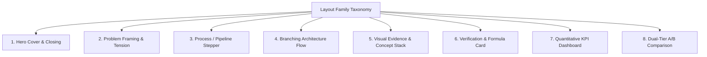
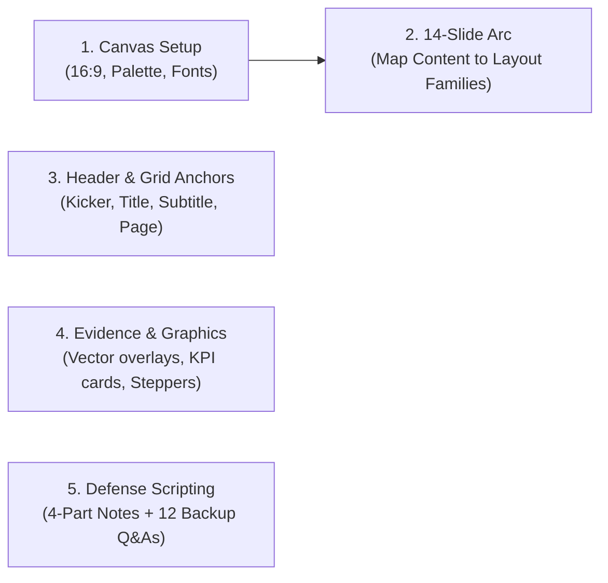

# PPTX DESIGN SYSTEM REVERSE-ENGINEERING GUIDE
**Reference Deck:** `Panorama_Stitching_14_Slides.pptx`  
**Output Path:** `reference_design_analysis/DESIGN_GUIDE.md`  
**Analysis Date:** October 2026  
**Methodology:** Binary & OpenXML structural inspection (`python-pptx`, `zipfile`, `drawingml` XML tree) cross-verified against rendered slide visual captures.

---

## EXECUTIVE SUMMARY & METRIC BASELINE

The reference presentation `Panorama_Stitching_14_Slides.pptx` is an elite academic defense deck engineered for a high-stakes computer vision project defense. Rather than following generic slide templates with bullet points and decorative flourishes, the deck embodies a **Swiss/International Typographic Style** combined with **Evidence-First Engineering Transparency**.

### Measured Deck Dimensions
* **Slide Dimensions:** `960.00 pt × 540.00 pt` (measured via `p:sldSz`), exactly `13.333 in × 7.500 in` (`12,192,000 × 6,858,000 EMU`).
* **Aspect Ratio:** `16:9` widescreen widescreen standard.
* **Canvas Background:** Pure Solid White (`#FFFFFF`, XML: `<a:srgbClr val="FFFFFF"/>`), 100% consistent across all 14 slides.
* **Drop Shadows / 3D Bevels / Gradients:** `0%` (0 instances of `<a:effectLst>` or gradient fills across all 14 slides).
* **Geometry Language:** Exclusively sharp rectangles (`rect`) and perfect circles (`ellipse`), combined with straight freeform connectors (`FREEFORM`).

---

## 1. DESIGN PRINCIPLES

1. **Active Assertion Headlines (No Passive Labels):**
   * Titles are complete declarative statements summarizing the core insight or finding of that slide (e.g., *"Một pipeline, ba bài toán chính"*, *"Phân tích ảnh nhỏ, dựng từ ảnh gốc"*, *"Góc nhìn rộng cần phép chiếu phù hợp"*).
   * Generic, passive titles such as *"Tổng quan"*, *"Thuật toán"*, *"Kiến trúc"* or *"Kết quả"* are strictly avoided.
2. **Subtitles as Operational Explanations:**
   * Every title is immediately supported by a subordinate subtitle sentence (`16.5 pt`) that provides the technical mechanism or engineering compromise (e.g., *"Cân bằng sáng, chọn đường nối và trộn theo trọng số"*).
3. **Evidence-First Visual Hierarchy:**
   * Visual assets (real photos, pipeline diagrams, vector keypoints, before/after comparisons) occupy `60%–70%` of the active slide area. Text is condensed into scannable cards, badges, and metric callouts.
4. **Complete Elimination of Generic Bullet Points:**
   * There is **not a single bullet point** (`•`) anywhere in the deck. Sequential lists are converted into numbered round badges (`01`, `02`, `03`), architectural cards, or bold inline lead-ins.
5. **Radical Engineering Transparency & Humility:**
   * Numbers are reported with empirical precision (e.g., `19,99 s`, `831 MB`, `226 / 249`). Limitations, compromises, and caveats are explicitly displayed in captions and disclaimers (e.g., *"100 MP có nội suy. Parallax và vật chuyển động vẫn là giới hạn"*).
6. **Persistent Visual Anchors:**
   * Every slide maintains three strictly positioned anchor elements:
     * **Top Kicker Bar:** Accent royal blue bar at `(x=48.0 pt, y=33.0 pt, w=27.0 pt, h=3.75 pt)`.
     * **Title Box:** Left-aligned at `(x=48.0 pt, y=48.75 pt, w=864.0 pt)`.
     * **Slide Counter:** Fixed bottom-right two-digit page number at `(x=892.5 pt, y=510.0 pt)`.

---

## 2. MEASURED COLOR PALETTE

The color system relies on high contrast between deep navy, crisp white, and vivid royal blue, supplemented by turquoise for empirical success and warm amber for alerts/rejections.

| Role | Color Name | HEX Code | Measured Occurrences | XML / CSS Usage | Semantic Role in Deck |
| :--- | :--- | :--- | :--- | :--- | :--- |
| **Canvas Background** | Pure White | `#FFFFFF` | 14 slides, 55 shapes | `<a:srgbClr val="FFFFFF"/>` | Clean, high-legibility canvas; card backgrounds |
| **Primary Typography** | Deep Midnight Navy | `#132E57` | 58 text runs, 1 fill | `<a:srgbClr val="132E57"/>` | Primary slide titles, card headers, high-contrast text |
| **Secondary Typography** | Slate Gray-Blue | `#526985` | 45 text runs | `<a:srgbClr val="526985"/>` | Subtitles, body descriptions, metadata tags, page counters |
| **Primary Brand Accent** | Vivid Royal Blue | `#165DDE` | 29 text runs, 78 fills, 15 strokes | `<a:srgbClr val="165DDE"/>` | Kicker bars, step badges, active titles, formula highlights, stat numbers |
| **Active Surface Tint** | Ice Blue Fill | `#EAF2FF` | 7 shape fills | `<a:srgbClr val="EAF2FF"/>` | Active cards (e.g., Slide 4 pipeline step), active pixel grid cells |
| **Muted Surface Tint** | Soft Off-White Blue | `#F3F7FC` | 1 shape fill | `<a:srgbClr val="F3F7FC"/>` | Secondary cards (e.g., Slide 4 raw asset holding) |
| **Data Overlay (Inlier)** | Vibrant Turquoise Cyan | `#23A8CE` | 147 strokes | `<a:srgbClr val="23A8CE"/>` | SIFT keypoint circles, valid correspondence vectors, inlier match lines |
| **Data Overlay (Outlier)** | Warm Ochre Amber | `#B76A12` | 1 fill, 5 strokes | `<a:srgbClr val="B76A12"/>` | RANSAC rejected match lines, sub-pixel center interpolation point |
| **Structural Hairline** | Subtle Border Slate | `#D8E4F2` | 83 strokes | `<a:srgbClr val="D8E4F2"/>` | Grid lines, connecting axes, card separators, vertical dividers |

> [!NOTE]
> All colors above were measured directly from the OpenXML shape definitions (`p:sp/p:spPr/a:solidFill` and `a:rPr/a:solidFill`). PPTX theme defaults (`Aptos`, Office 365 default palette) are completely overridden by direct RGB color formatting.

---

## 3. TYPOGRAPHY HIERARCHY

The deck uses a single font family across all slides: **`Segoe UI`** (measured across 146 text runs, 100% adherence). Font sizing is strictly calibrated into distinct functional tiers.

```
+-----------------------------------------------------------------------------+
| [Kicker: 27 x 3.75 pt #165DDE]                                              |
| SLIDE TITLE (31.5 pt Bold #132E57)                                          |
| Slide Subtitle / Operational Mechanism (16.5 pt Regular #526985)            |
+-----------------------------------------------------------------------------+
|                                                                             |
|  [CARD / STAGE HEADING] (19.5 - 23.25 pt Bold #165DDE or #132E57)          |
|  Body Description / Technical Text (16.5 - 18.75 pt Regular #132E57)       |
|                                                                             |
|  [HERO METRIC / BIG STAT] (48.75 - 62.25 pt Bold #165DDE)                  |
|  [FORMULA DISPLAY] (26.25 - 47.25 pt Bold #165DDE)                          |
|                                                                             |
|  Caption / Disclaimer / Source Reference (12.75 - 14.25 pt Regular #526985) |
|                                                                  [Page: 01] |
+-----------------------------------------------------------------------------+
```

### Detailed Font Hierarchy Table

| Semantic Role | Font Family | Size (pt) | Weight | Measured Color | Case / Alignment | Slide Examples |
| :--- | :--- | :--- | :--- | :--- | :--- | :--- |
| **Deck Title (Line 1)** | Segoe UI | `52.5 pt` | Bold | `#132E57` | UPPERCASE, Left | Slide 1 (`PANORAMA`) |
| **Deck Title (Line 2)** | Segoe UI | `46.5 pt` | Bold | `#165DDE` | UPPERCASE, Left | Slide 1 (`STITCHING`) |
| **Deck Subtitle** | Segoe UI | `21.0 pt` | Regular | `#132E57` | Sentence case, Left | Slide 1 (`Từ những ảnh rời...`) |
| **Slide Master Title** | Segoe UI | `31.5 pt` | Bold | `#132E57` | Sentence case, Left | Slides 2–13 |
| **Closing Hero Title** | Segoe UI | `43.5 pt` | Bold | `#132E57` / `#165DDE` | 2 lines, Left | Slide 14 |
| **Slide Master Subtitle** | Segoe UI | `16.5 pt` | Regular | `#526985` | Sentence case, Left | Slides 2–9, 11–13 |
| **Hero Big Number / KPI** | Segoe UI | `62.25 pt` / `48.75 pt` | Bold | `#165DDE` | Numeric, Left | Slide 8 (`226`), Slide 13 (`19,99 s`, `100 MP`, `831 MB`) |
| **Math Formula Display** | Segoe UI | `47.25 pt` / `26.25 pt` | Bold | `#165DDE` | Mathematical symbols | Slide 7 (`x′ ∼ Hx`), Slide 6 (`d₁ < 0,75 d₂`) |
| **Card / Stage Title** | Segoe UI | `19.5 pt` – `23.25 pt` | Bold | `#165DDE` or `#132E57` | Title / Sentence case | Slides 4, 5, 7, 9, 11, 12 |
| **Step Badge Text** | Segoe UI | `11.25 pt` – `15.75 pt` | Bold | `#FFFFFF` | Centered in Circle | Slides 3, 8, 9 (`01`–`05`, `1`–`4`) |
| **Body Primary Text** | Segoe UI | `16.5 pt` – `18.75 pt` | Regular / Bold | `#132E57` | Sentence case, Left | All content slides |
| **Metadata Tag / Kicker** | Segoe UI | `13.5 pt` – `15.0 pt` | Regular / Bold | `#526985` / `#132E57` | UPPERCASE label | Slide 1 (`THÀNH VIÊN`), Slide 4 (`ẢNH ĐẦU VÀO`), Slide 10 (`PHẲNG`) |
| **Caption / Disclaimer** | Segoe UI | `12.75 pt` – `14.25 pt` | Regular | `#526985` | Sentence case, Left | Slides 2, 3, 5, 7, 8, 10, 11, 13 |
| **Persistent Page Counter**| Segoe UI | `11.25 pt` | Regular | `#526985` | Two digits (`01`–`14`), Right | All slides 1–14 at `(892.5, 510.0)` |

---

## 4. LAYOUT SPECIFICATIONS & SPATIAL GRID

### Global Canvas Dimensions
* **Width:** `960.00 pt` (100% of slide canvas)
* **Height:** `540.00 pt` (100% of slide canvas)
* **Left Margin:** `48.00 pt` (5.00% of canvas width)
* **Right Margin:** `48.00 pt` (content terminates at `912.00 pt`, leaving `48.00 pt`)
* **Usable Content Width:** `864.00 pt` (`960 - 48 × 2`)

### Standardized Header Zone (Slides 02 – 13)
* **Kicker Accent Bar:** `left = 48.0 pt`, `top = 33.0 pt`, `width = 27.0 pt`, `height = 3.75 pt`, fill `#165DDE`.
* **Slide Title:** `left = 48.0 pt`, `top = 48.75 pt`, `width = 864.0 pt`, `height = 48.75 pt`.
* **Slide Subtitle:** `left = 48.0 pt`, `top = 101.25 pt`, `width = 864.0 pt`, `height = 33.75 pt`.
* **Header Baseline:** `top = 135.0 pt` (all slide content starts at `y ≥ 142.5 pt`).

### Standardized Footer Zone
* **Slide Number (Page):** `left = 892.5 pt`, `top = 510.0 pt`, `width = 21.0 pt`, `height = 18.0 pt`.
* **Bottom Safety Margin:** `12.0 pt` to slide bottom; major content terminates at `y ≤ 500.0 pt`.

### Content Grids
```
Grid 1: Full-Bleed Hero (Slides 1, 14)
[==================== 960 pt (Edge-to-Edge) ====================]

Grid 2: 2-Column Split (Slides 5, 6, 11)
[-- 48 pt --] [== Left Column: 412.5 pt ==] [-- 39 pt --] [== Right Column: 412.5 pt ==] [-- 48 pt --]

Grid 3: 3-Column Pillar / KPI Grid (Slides 8, 11, 13)
[-- 48 pt --] [Col 1: 273.75 pt] [- 32 pt -] [Col 2: 273.75 pt] [- 32 pt -] [Col 3: 273.75 pt] [-- 48 pt --]

Grid 4: 5-Stage Sequential Stepper (Slides 3, 9)
[-- 48 pt --] [Step 1] [- 12 pt -] [Step 2] [- 12 pt -] [Step 3] [- 12 pt -] [Step 4] [- 12 pt -] [Step 5] [-- 48 pt --]
```

---

## 5. REUSABLE SLIDE PATTERNS (TAXONOMY OF 8 LAYOUT FAMILIES)

The 14 slides in the deck do not follow a repetitive layout; instead, they draw from **8 distinct layout families** matched to specific rhetorical needs.



### Family 1: Hero Cover & Closing (Slides 01, 14)
* **Purpose:** High-impact bookends establishing the visual identity and delivering the memorable core thesis.
* **Layout Geometry:**
  * Top-heavy typographic lockup (`PANORAMA` in navy, `STITCHING` in blue; or 2-line takeaway).
  * Full-bleed horizontal hero panorama (`left = 0.0 pt`, `width = 960.0 pt`, `height = 243.0 pt`, `top = 217.5 pt` or `238.5 pt`).
  * Bottom metadata zone (Slide 1: two columns for authors and advisor; Slide 14: 3-part takeaway motto).

### Family 2: Problem Framing & Tension Definition (Slide 02)
* **Purpose:** Exposing why the problem is difficult before introducing the solution.
* **Layout Geometry:**
  * Top-Left: Two side-by-side unaligned input photos (`262.5 × 196.88 pt`).
  * Top-Right: 3 stacked numbered problem callouts (`01`, `02`, `03` in accent blue with bold titles).
  * Bottom: Warning caption + full-width panoramic strip (`863.11 × 87.75 pt`) exhibiting failure/distortion.

### Family 3: System Pipeline & Architecture Stepper (Slides 03, 08)
* **Purpose:** Providing a macroscopic map of the entire methodology or loop.
* **Layout Geometry:**
  * Slide 3: Centered isometric 3D pipeline visualization / video (`806.9 × 292.5 pt`), anchored below by a horizontal axis line (`#165DDE`) and 5 round numbered badges (`22.5 pt` diameter) with stage labels.
  * Slide 8: 4-stage algorithmic stepper across top with loopback arrow (`#165DDE` curved line labeled *"Lặp nhiều lần"*).

### Family 4: Branching Architecture & Decision Flow (Slide 04)
* **Purpose:** Explaining dual-path data flow and engineering trade-offs.
* **Layout Geometry:**
  * Left: Input image card (`165.0 × 123.75 pt`).
  * Center: Two vertically stacked rounded rectangular cards (`270.0 × 108.75 pt`):
    * Top Card: Active fast-path (`#EAF2FF` ice blue fill).
    * Bottom Card: Full-fidelity asset holding (`#F3F7FC` soft neutral fill).
  * Right: Output destination thumbnail.
  * Connectors: Orthogonal branching lines (`#165DDE`, `0.75 pt`).
  * Bottom Banner: Standout engineering takeaway (`18.75 pt` bold royal blue).

### Family 5: Visual Evidence + Structured Definition Stack (Slides 05, 12)
* **Purpose:** Pairing empirical image data with technical terminology definitions.
* **Layout Geometry:**
  * Left Side: Large visual panel (`465.0 × 348.75 pt`) featuring real dataset images with overlaid vector graphics (e.g. SIFT circles in cyan `#23A8CE` or inverse pixel coordinate grid).
  * Right Side: Two conceptual blocks separated by a light horizontal hairline (`#D8E4F2`), each containing a `22.5 pt` bold accent blue title and navy description runs.

### Family 6: Correspondence Verification & Formula Highlight (Slides 06, 07)
* **Purpose:** Connecting mathematical formulation directly to empirical point matching.
* **Layout Geometry:**
  * Top: Side-by-side image comparison with cross-panel vector match lines (`#23A8CE`) and endpoint dots (`#165DDE` with `#FFFFFF` stroke).
  * Bottom-Left: Large standout mathematical card (`d₁ < 0,75 d₂` or `x′ ∼ Hx` in `26.25 pt` – `47.25 pt` bold accent blue).
  * Bottom-Right: Spoken rationale text explaining the formula in plain language.

### Family 7: Multi-Item Comparison & Tiered Benchmarking (Slides 09, 10, 11)
* **Purpose:** Direct head-to-head evaluation of competing methods or processing stages.
* **Layout Geometry:**
  * Slide 9: 5 horizontal thumbnails linked by an axis line, highlighting reference image #3 in dark navy, followed by a 2-column comparative card layout.
  * Slide 10: Two stacked full-width comparison strips (Tier 1: *"PHẲNG - Độ giãn 4,08×"*; Tier 2: *"HÌNH TRỤ - Độ giãn 1,26×"*).
  * Slide 11: Side-by-side A/B images (Hard seam vs Seamless blend) with 3 supporting pillar cards below.

### Family 8: Quantitative KPI Dashboard (Slide 13)
* **Purpose:** Delivering empirical results with executive clarity and academic integrity.
* **Layout Geometry:**
  * Top Row: 3 equal-width KPI metric blocks (`left = 48.0 pt`, `354.0 pt`, `660.0 pt`, `w = 296.25 pt`):
    * Massive Number: `48.75 pt` bold royal blue (`19,99 s`, `100 MP`, `831 MB`).
    * Metric Label: `17.25 pt` regular navy below.
  * Center: Wide panorama stitched result (`862.58 × 219.0 pt`).
  * Bottom: Mandatory technical disclaimer (`14.25 pt` slate gray).

---

## 6. IMAGE AND DIAGRAM GUIDELINES

1. **Aspect Ratios & Dimensions:**
   * **Full-Bleed Hero Strip:** `960 pt × ~243 pt` (approx. `4:1` ultra-wide panorama).
   * **In-Content Wide Strip:** `862.58 pt × ~88–219 pt` (approx. `10:1` or `4:1`).
   * **Standard In-Content Photo:** `4:3` ratio (`262.5 × 196.88 pt`, `375.0 × 281.25 pt`, or `162.0 × 121.5 pt`).
2. **Direct Vector Annotations in PPTX:**
   * Keypoints, match lines, grid cells, and arrows are **not burned into the bitmaps**. They are rendered as native PPTX shapes (`FREEFORM` lines, `ellipse` shapes) placed directly on top of the images.
   * **Inlier / Verified Match:** Cyan stroke (`#23A8CE`), `0.75 pt` – `1.5 pt` weight.
   * **Outlier / Rejected Match:** Warm amber stroke (`#B76A12`), `0.75 pt` – `1.5 pt` weight.
   * **Keypoint Dots:** `4.5 pt` diameter circle, filled with `#165DDE` and bordered with `0.75 pt` `#FFFFFF` stroke to ensure visibility over complex image backgrounds.
3. **Card Fill & Border Styling:**
   * **Standard Active Card:** Fill `#EAF2FF`, no outline.
   * **Standard Neutral Card:** Fill `#F3F7FC`, no outline.
   * **Outlined Card / Grid Cell:** Fill `#FFFFFF`, outline `#D8E4F2` (`0.75 pt`).
   * **Dividing Lines:** Solid line, stroke `#D8E4F2`, width `0.75 pt` (`9525 EMU`).
4. **Video and Animation Integration:**
   * Embedded MP4 media (`media1.mp4`, `media2.mp4`) are paired with high-resolution static poster frames (`VIDEO_PIPELINE_POSTER`, `VIDEO_HOMOGRAPHY_POSTER`).
   * Presenters can click to play the 6–8 second animation or seamlessly continue using the static poster if media fails.

---

## 7. CONTENT DENSITY & COPYWRITING RULES

1. **The 1-Idea-Per-Slide Rule:**
   * Each slide has exactly one primary thesis statement embodied in the title.
2. **Title Syntax Pattern:**
   * `[Action / Cause], [Result / Insight]` or `[Subject] [Specific Predicate]`
   * Examples:
     * *"Phân tích ảnh nhỏ, dựng từ ảnh gốc"* (Verb phrase + Verb phrase)
     * *"Giống nhau chưa có nghĩa là khớp đúng"* (Philosophical engineering insight)
     * *"RANSAC giữ những điểm nhất quán hình học"* (Subject + precise technical action)
3. **Subtitle Syntax Pattern:**
   * `[Technique 1], [Technique 2] và [Technique 3]` or `[Mechanism] [Outcome]`
   * Example: *"Matching KNN, Lowe ratio test và kiểm tra hai chiều"*
4. **Number Formatting:**
   * Vietnamese locale comma for decimals: `19,99 s`, `4,08×`, `1,26×`, `0,75`.
   * Clear physical units attached: `s`, `MP`, `MB`, `×`.
5. **Transparency & Disclaimer Rule:**
   * Never state a benchmark without its test conditions (e.g., input resolution, machine specs, or interpolation caveats).

---

## 8. SPEAKER NOTES, TIMING & BACKUP Q&A ARCHITECTURE

A defining excellence of this deck is the rigorous structure of the speaker notes across all 14 slides. Every slide contains an identical 4-part notes schema:

```markdown
THỜI LƯỢNG: [Duration in seconds]. Mốc dự kiến [Start]–[End]. Tổng bài nói [Total time]; dành [Q&A time] cho vấn đáp.
LỜI TRÌNH BÀY
[Word-for-word spoken script matching the slide visuals. Natural, conversational, highly academic.]
ĐIỀU KHIỂN / DỰ PHÒNG
[Presenter staging cues: when to pause, video playback clicks, fallback verbal pathways if animations fail.]
NGUỒN VÀ PHẠM VI
[Engineering ground truth: exact code filenames, datasets, benchmark output files, disclaimers, caveats.]
```

### Measured Pacing Strategy
* **Total Spoken Time:** Exactly `9 phút 40 giây` (580 seconds).
* **Average Pace:** `~41.4 seconds` per slide (ranging from `25s` for Title/Closing to `55s` for RANSAC & Projections).
* **Defense Allocation:** Designed for a standard 15-minute academic slot: `9m 40s presentation + ~5m 20s committee defense`.

### Anticipatory Defense Backup Q&A (Slide 14)
Slide 14 includes **12 pre-formulated defense answers** (`PHẦN VẤN ĐÁP DỰ PHÒNG — KHÔNG ĐỌC TRONG BÀI NÓI`) that address the most aggressive questions examiners might ask:
1. Clarifying custom codebase vs library code (OpenCV vs scratch implementation).
2. Justifying why both Lowe ratio test and RANSAC are needed.
3. Mathematical justification for minimal 4 point pairs in homography.
4. Numerical conditioning advantage of Normalized DLT (Hartley preconditioning).
5. 3D scene / parallax limitations of homography.
6. Planar vs cylindrical projection trade-offs.
7. Decision variables for auto-projection selection.
8. Truth about 100 MP interpolation vs optical sensor resolution.
9. Why closed crop does not prove zero ghosting/misalignment.
10. Theoretical justification for backward inverse mapping over forward splatting.
11. Statistical honesty regarding charter targets (e.g. 80% success rate claim).
12. Roadmaps for multi-band blending and parallax handling.

---

## 9. COMMON MISTAKES TO AVOID (ANTI-PATTERNS)

| Anti-Pattern | Why It Breaks the System | Correct Reference Deck Pattern |
| :--- | :--- | :--- |
| **Bullet Points (`•`)** | Causes passive, boring reading; signals amateur deck | Use numbered step badges (`01`, `02`), cards, or bold run leads |
| **Topic-Only Titles** | (e.g., "Thuật toán RANSAC") Fails to state the insight | Active headline: *"RANSAC giữ những điểm nhất quán hình học"* |
| **Missing Kicker Bar** | Breaks visual continuity across the slide deck | Retain `27 × 3.75 pt` blue kicker at `(48.0, 33.0)` on every slide |
| **Drop Shadows / 3D Effects** | Adds clutter; ruins modern Swiss minimalist aesthetic | Flat design only: clean fills (`#FFFFFF`, `#EAF2FF`), hairlines (`#D8E4F2`) |
| **Mixed Font Families** | Destroys typographic coherence | 100% `Segoe UI` across all titles, body, badges, and numbers |
| **Over-Promising Claims** | Ruins credibility before academic examiners | State caveats clearly: *"100 MP có nội suy. Parallax là giới hạn"* |
| **Burned-In Annotations** | Blurry, non-vector, cannot be tweaked or translated | Draw native PPTX vector circles (`#23A8CE`) and lines over photos |
| **Unscripted Speaker Notes** | Leads to rambling and exceeding the 10-minute defense limit | Use strict 4-part notes: Duration, Script, Staging cues, Source truth |

---

## 10. REUSABLE WORKFLOW: APPLYING TO ANY ACADEMIC TOPIC

This design system can be applied to any technical domain (e.g., Deep Learning, Distributed Systems, Compilers, Robotics, Bioinformatics, Embedded Systems).

### 5-Step Adaptation Pipeline



#### Step 1: Canvas & Master Setup
* Set slide dimensions to `960 pt × 540 pt` (`13.333 in × 7.5 in`, 16:9).
* Set default background to pure solid white (`#FFFFFF`).
* Define theme colors in PPTX / python-pptx:
  * Primary Text: `#132E57`
  * Secondary Text: `#526985`
  * Accent Brand: `#165DDE`
  * Data Overlay 1: `#23A8CE` (Success / Inlier / Normal)
  * Data Overlay 2: `#B76A12` (Warning / Outlier / Alert)
  * Hairline: `#D8E4F2`
* Enforce `Segoe UI` as the universal typeface.

#### Step 2: Map the 14-Slide Narrative Rhythm
Map the new subject matter to the exact rhetorical progression:
* **Slide 01 (Family 1):** Title & Hero Result Showcase.
* **Slide 02 (Family 2):** Problem Framing, Naive Failure Mode & Tension.
* **Slide 03 (Family 3):** High-Level System Architecture / End-to-End Pipeline.
* **Slide 04 (Family 4):** Core Architectural Decision (Dual-path / Fast vs Full trade-off).
* **Slide 05 (Family 5):** Deep Dive Phase 1: Input Processing / Feature Extraction + Visual Evidence.
* **Slide 06 (Family 6):** Deep Dive Phase 2: Filtering / Verification + Standout Math Formula.
* **Slide 07 (Family 7):** Mathematical Foundation / Algorithmic Derivation + Procedural 3-Step.
* **Slide 08 (Family 3/8):** Algorithmic Loop / Outlier Rejection + Loopback Arrow + Hero Stat Number.
* **Slide 09 (Family 7):** Global Optimization / Multi-entity Coordination + Comparative Split.
* **Slide 10 (Family 7):** Comparative Model Evaluation (Baseline vs Proposed Tiered Strips).
* **Slide 11 (Family 7):** Output Refinement / Smoothing / Blending + 3 Solution Pillars.
* **Slide 12 (Family 5):** Low-Level Engineering & Memory Architecture (Tiling, Caching, Mapping).
* **Slide 13 (Family 8):** Quantitative Results & Benchmark Dashboard (3 Giant KPIs + Final Result).
* **Slide 14 (Family 1):** Conclusion, 3-Part Takeaway Motto & Ready for Defense.

#### Step 3: Implement Visual Anchors
* Copy the persistent anchor group onto every slide:
  * Kicker bar: `left=48.0 pt`, `top=33.0 pt`, `width=27.0 pt`, `height=3.75 pt`, fill `#165DDE`.
  * Title box: `left=48.0 pt`, `top=48.75 pt`, `width=864.0 pt`, `height=48.75 pt`, font `31.5 pt` Bold `#132E57`.
  * Subtitle box: `left=48.0 pt`, `top=101.25 pt`, `width=864.0 pt`, `height=33.75 pt`, font `16.5 pt` Regular `#526985`.
  * Page number: `left=892.5 pt`, `top=510.0 pt`, `width=21.0 pt`, `height=18.0 pt`, font `11.25 pt` Regular `#526985`.

#### Step 4: Construct Data Displays & Vector Visuals
* For math equations: Use large standalone text frames (`26.25 pt` – `47.25 pt` bold accent blue) with plain-text explanations adjacent.
* For benchmarking: Use 3 top KPI boxes with giant numbers (`48.75 pt` – `62.25 pt` bold royal blue) and sub-labels (`17.25 pt` navy).
* For process steps: Use circle badges (`22.5 pt` diameter, `#165DDE` fill, `#FFFFFF` text) connected by `#D8E4F2` or `#165DDE` horizontal lines.

#### Step 5: Author Structured Speaker Notes & Backup Q&A
* Draft word-for-word scripts for every slide targeting `~40 seconds` per slide (`~9m 40s` total).
* Explicitly state presenter staging instructions under `ĐIỀU KHIỂN / DỰ PHÒNG`.
* Document code file paths and data limitations under `NGUỒN VÀ PHẠM VI`.
* On the closing slide notes, compile 10–12 aggressive defense Q&As covering design choices, limitations, mathematical assumptions, and future improvements.

---

### Verification Checklist for New Decks
- [ ] Canvas is 16:9 widescreen (`960 pt × 540 pt`) with solid `#FFFFFF` background.
- [ ] Blue kicker bar (`27 × 3.75 pt`) is present on every single slide at `(48.0, 33.0)`.
- [ ] All titles are active assertions (`31.5 pt` Bold `#132E57`) with operational subtitles (`16.5 pt` `#526985`).
- [ ] Two-digit slide number (`01`–`14`) is positioned at `(892.5, 510.0)` in `#526985`.
- [ ] No generic bullet points (`•`) used anywhere.
- [ ] Font is 100% `Segoe UI` across all elements.
- [ ] Drop shadows, 3D bevels, and gradient fills are 100% absent.
- [ ] Vector annotations (dots, arrows, match lines) use `#23A8CE` (inlier/success) and `#B76A12` (outlier/alert).
- [ ] Speaker notes follow the 4-part schema: Duration, Spoken Script, Staging Cues, Engineering Scope.
- [ ] Final slide includes a 10–12 question Backup Q&A defense bank.
